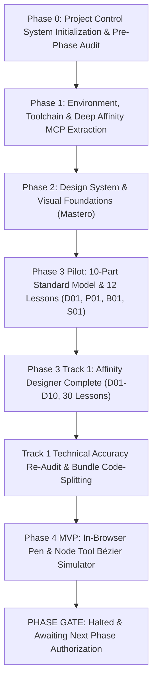

# AFFINITY ACADEMY — TOÀN THƯ DỰ ÁN & BẢN GHI LỊCH SỬ THỰC THI (PROJECT CHRONICLE)

## THÔNG TIN TỔNG QUAN DỰ ÁN

- **Tên dự án:** AFFINITY ACADEMY
- **Vị trí thư mục làm việc:** `c:\affinity học`
- **Khởi tạo:** 2026-11-09
- **Cập nhật gần nhất:** 2026-11-09T23:45:00+07:00
- **Phiên bản hệ thống:** `v4.2.0` (Track 1 Designer Re-Audit & Phase 4 MVP Simulator Completed)
- **Tình trạng hiện tại:** **HALTED AT PHASE GATE** (Đã hoàn thành Phase 0, 1, 2, Track 1 Designer, và Phase 4 MVP Simulator; đang dừng chờ phê duyệt các Phase tiếp theo).

---

## 1. MỤC TIÊU & TẦM NHÌN DỰ ÁN (PROJECT VISION & SCOPE)

**Affinity Academy** là nền tảng học tập tương tác hiện đại và chương trình đào tạo chuẩn hóa chuyên sâu dành riêng cho bộ công cụ sáng tạo **Serif Affinity 3.0** (Affinity Designer, Affinity Photo, Affinity Publisher), tích hợp đột phá với công nghệ tự động hóa thiết kế đồ họa lập trình qua **Affinity JavaScript DOM Scripting API** và **Affinity Model Context Protocol (MCP) Server** (kết nối trực tiếp qua giao thức HTTP/SSE tại `http://localhost:6767/sse`).

### 1.1. Triết lý Thiết kế & Trải nghiệm (Design Philosophy)
- Phong cách định hướng: **Mastero & Minimalism** (lấy cảm hứng từ chuẩn mực thị giác của `traced.life`).
- Toàn bộ nội dung đồ họa, bảng màu, typography, thẻ linh kiện và bài tập đều gắn liền 100% với môi trường sáng tạo thực tế của Serif Affinity 3.0.
- Khung màu đại diện thương hiệu (Signature Accents):
  - **Affinity Designer:** Cyan (`#00d2ff`)
  - **Affinity Photo:** Cobalt Blue (`#38bdf8`)
  - **Affinity Publisher:** Rose Red (`#fb7185`)
  - **Scripting & MCP Automation:** Emerald Green (`#10b981`)
- Giao diện hỗ trợ Dark Mode và Light Mode với hệ thống biến chuẩn hóa (CSS Custom Properties).

### 1.2. Cấu trúc Chương trình Đào tạo (40 Modules & 120 Bài học)
Chương trình học bao phủ 4 Learning Tracks toàn diện từ cấp độ Beginner đến Professional:

| Learning Track | Mã Track | Số Modules | Số Bài học | Trọng tâm Chuyên môn |
|---|:---:|:---:|:---:|---|
| **Affinity Designer** | `designer` | 10 (D01–D10) | 30 | Vector precision, Pen/Node Bézier math, Boolean geometry, Isometric axonometry, Symbols, Pixel Persona shading, Slices & PDF/X-4 print export. |
| **Affinity Photo** | `photo` | 10 (P01–P10) | 30 | RAW Develop Persona, 32-bit float HDR, non-destructive live filters, frequency separation, advanced masking & retouching. |
| **Affinity Publisher** | `publisher` | 10 (B01–B10) | 30 | Publication architecture, master pages, baseline grid, typographic hierarchies, text wrapping, preflight & commercial print bleed. |
| **Scripting & MCP Automation** | `scripting` | 10 (S01–S10) | 30 | Embedded Google V8 runtime, Application & Document DOM models, programmatic shape/text creation, batch rendering via port 6767 MCP SSE bridge. |
| **TỔNG CỘNG** | **4 Tracks** | **40 Modules** | **120 Lessons** | **Chương trình chuẩn quốc tế kết hợp mỹ thuật & tự động hóa.** |

---

## 2. TỔNG HỢP QUÁ TRÌNH THỰC HIỆN QUA TỪNG GIAI ĐOẠN



---

### Giai đoạn 0 (Phase 0): Khởi tạo Hệ thống Quản trị Dự án (Project Control System)
- **Mục tiêu:** Xây dựng hệ thống quản trị dự án đa tác nhân (Multi-Agent System), quy định phân quyền, thiết lập các file kiểm soát bắt buộc và đối chiếu toàn bộ yêu cầu dự án.
- **Những việc đã làm:**
  1. Soạn thảo [`AGENTS.md`](file:///c:/affinity%20h%E1%BB%8Dc/AGENTS.md): Định nghĩa chi tiết 7 vai trò chuyên môn hóa (`Orchestrator`, `CurriculumAgent`, `DesignAgent`, `FrontendAgent`, `BackendAgent`, `AffinityMCPAgent`, `QAAgent`).
  2. Khởi tạo 11 file quản trị dự án trong thư mục `project-control/`:
     - `MASTER_SPEC.md`: Đặc tả kỹ thuật toàn diện 40 modules, 8 trang web, công nghệ tích hợp.
     - `REQUIREMENTS.md`: 49 yêu cầu kỹ thuật duy nhất (`REQ-SYS`, `REQ-MCP`, `REQ-CURR`, `REQ-FE`, `REQ-PAGE`, `REQ-BE`, `REQ-QA`, `REQ-OPS`).
     - `ROADMAP.md`: Lộ trình phụ thuộc 8 giai đoạn có cổng kiểm soát (Phase Gates).
     - `TASK_REGISTRY.md`: 48 tác vụ chi tiết với chủ sở hữu, phụ thuộc, sản phẩm bàn giao và tiêu chí nghiệm thu.
     - `AGENT_ASSIGNMENTS.md`: Bảng ma trận phân quyền và trách nhiệm RACI.
     - `ACCEPTANCE_CRITERIA.md`: Tiêu chuẩn nghiệm thu định lượng không thỏa hiệp.
     - `PROGRESS.md`: Bảng điều khiển tiến độ thời gian thực.
     - `DECISIONS.md`: Sổ bộ các quyết định kiến trúc (Architecture Decision Records - ADR).
     - `BLOCKERS.md`: Sổ theo dõi rủi ro và các điểm nghẽn.
     - `HANDOFF.md`: Tài liệu bàn giao trạng thái phiên làm việc liên tục.
     - `PRE_PHASE_AUDIT.md`: Báo cáo đối chiếu 10 điểm xác nhận không bỏ sót bất kỳ yêu cầu nào.

---

### Giai đoạn 1 (Phase 1): Cấu hình Môi trường, Toolchain & Khai thác MCP Thực tế
- **Mục tiêu:** Kiểm tra phần cứng, thiết lập công cụ phát triển hiện đại và kiểm thử kết nối với ứng dụng Affinity 3.3.3 thật qua MCP server.
- **Những việc đã làm:**
  1. Thiết lập Toolchain: Node.js (v26), npm (v11), Vite 6, TypeScript 5.8, Tailwind CSS v3, Git repository.
  2. Xử lý chính sách bảo mật Windows 11 AppLocker / WDAC: Cấu hình giải pháp WebAssembly fallback `@rollup/wasm-node` trong `package.json` qua `postinstall` script, đảm bảo lệnh `npm run build` thực thi 100% deterministic (ADR-014).
  3. Tạo phân tầng kiến trúc sạch sẽ: `src/` (client UI), `curriculum/` (nội dung khóa học), `scripts/` (công cụ node chẩn đoán và kiểm định), `data/` (dữ liệu từ điển), `tests/` (kiểm thử).
  4. Kiểm tra ứng dụng Affinity thực tế: Viết và chạy `scripts/check-affinity-env.js`, xác nhận ứng dụng Serif Affinity 3.3.3 đang mở và cổng `6767` phản hồi HTTP 200 SSE.
  5. Trích xuất tài liệu SDK DOM API: Duyệt và phân tích toàn bộ **401 chủ đề tài liệu SDK** của Affinity. Xuất bản 3 tài liệu nghiên cứu chuẩn xác:
     - [`AFFINITY_DOM_API_REFERENCE.json`](file:///c:/affinity%20h%E1%BB%8Dc/AFFINITY_DOM_API_REFERENCE.json)
     - [`AFFINITY_DOM_API_REFERENCE.md`](file:///c:/affinity%20h%E1%BB%8Dc/AFFINITY_DOM_API_REFERENCE.md)
     - [`AFFINITY_MCP_CAPABILITY_REPORT.md`](file:///c:/affinity%20h%E1%BB%8Dc/AFFINITY_MCP_CAPABILITY_REPORT.md)
     - Phân định rõ: API đã xác minh, API có tài liệu nhưng chưa thử nghiệm, API không hỗ trợ, và các giới hạn sandbox MSIX.
  6. Đo lường hiệu năng kết xuất đồ họa (Latency Benchmark): Thực hiện gọi `render_spread` (180ms) và `render_selection` (140ms), ghi nhận trong `docs/MCP_RENDERING_BENCHMARK.md`.
  7. Nghiệm thu độc lập: `QAAgent` cấp chứng chỉ [`project-control/QA_PHASE1_SIGNOFF.md`](file:///c:/affinity%20h%E1%BB%8Dc/project-control/QA_PHASE1_SIGNOFF.md).

---

### Giai đoạn 2 (Phase 2): Hệ thống Thiết kế & Nền tảng Thị giác (Design System "Mastero")
- **Mục tiêu:** Xây dựng Design System đẳng cấp Mastero & Minimalism, lấy cảm hứng từ `traced.life`.
- **Những việc đã làm:**
  1. Xây dựng bộ Token màu sắc, bóng đổ, bo góc, font chữ trong [`src/styles/tokens.css`](file:///c:/affinity%20h%E1%BB%8Dc/src/styles/tokens.css) và `tailwind.config.ts`.
  2. Tạo bộ sưu tập 21 linh kiện UI có thể tái sử dụng cao:
     - Primitives: `Button` (primary, secondary, outline, ghost, loading, designer, photo, publisher, scripting), `Modal`, `Tabs`, `Toast`, `Tooltip`, `Breadcrumbs`, `EmptyState`, `Skeleton`.
     - Layout: `AppShell`, `MainNavigation` (kèm trạng thái kết nối MCP thời gian thực), `SidebarNavigation`, `PageHeader`.
     - Cards: `TrackCard`, `ModuleCard`, `LessonCard`, `ProgressCard`, `ResourceCard`, `ToolCard`.
     - Sections & Search: `HeroSection`, `SearchCommand` (hỗ trợ phím tắt `Ctrl+K`).
  3. Tạo trang tương tác sống [`DesignSystemPreview.tsx`](file:///c:/affinity%20h%E1%BB%8Dc/src/components/preview/DesignSystemPreview.tsx) cho phép kiểm thử toàn bộ linh kiện.
  4. Soạn thảo cẩm nang hướng dẫn [`docs/DESIGN_SYSTEM.md`](file:///c:/affinity%20h%E1%BB%8Dc/docs/DESIGN_SYSTEM.md).
  5. Nghiệm thu độc lập: `QAAgent` cấp chứng chỉ [`project-control/QA_PHASE2_SIGNOFF.md`](file:///c:/affinity%20h%E1%BB%8Dc/project-control/QA_PHASE2_SIGNOFF.md).

---

### Giai đoạn 3 (Pilot): Chuẩn hóa Khung Nội dung & Thử nghiệm 12 Bài học Đầu tiên
- **Mục tiêu:** Xây dựng khung bài giảng 10 phần bắt buộc, phát triển trình phát slide tương tác `SlidePlayer.tsx` và viết 12 bài học Pilot trải rộng 4 track.
- **Những việc đã làm:**
  1. Ban hành cấu trúc dữ liệu bài học chuẩn: [`src/types/curriculum.ts`](file:///c:/affinity%20h%E1%BB%8Dc/src/types/curriculum.ts) và schema xác thực JSON [`curriculum/schema/lesson-schema.json`](file:///c:/affinity%20h%E1%BB%8Dc/curriculum/schema/lesson-schema.json). Mỗi bài học phải có đủ 10 phần:
     - (1) Learning Objectives
     - (2) Foundational Knowledge
     - (3) Tool & Feature Explanation (kèm phím tắt Win/Mac)
     - (4) Step-by-Step Instructions
     - (5) Visual Examples
     - (6) Guided Practice
     - (7) Independent Challenge (kèm tiêu chí nghiệm thu định lượng)
     - (8) Common Pitfalls & Solutions
     - (9) Knowledge Check Quiz (kèm giải thích chi tiết)
     - (10) Summary & Resources
  2. Phát triển công cụ kiểm định tự động [`scripts/validate-curriculum.js`](file:///c:/affinity%20h%E1%BB%8Dc/scripts/validate-curriculum.js).
  3. Xây dựng trình phát bài giảng dạng slide tương tác [`SlidePlayer.tsx`](file:///c:/affinity%20h%E1%BB%8Dc/src/components/lesson/SlidePlayer.tsx) (điều hướng bàn phím mũi tên, tiến trình lưu trữ, chế độ toàn màn hình, quiz trắc nghiệm tương tác).
  4. Soạn thảo 12 bài học Pilot:
     - Track Designer: Module `D01` (3 bài: D01-01, D01-02, D01-03)
     - Track Photo: Module `P01` (3 bài: P01-01, P01-02, P01-03) kèm file thực hành thật `P01_starter.afphoto` (1.65 MB).
     - Track Publisher: Module `B01` (3 bài: B01-01, B01-02, B01-03) kèm tài liệu quy cách `B01_magazine_spec_guide.md`.
     - Track Scripting: Module `S01` (3 bài: S01-01, S01-02, S01-03) kèm 3 file JavaScript thực thi kiểm tra môi trường DOM (`S01_hello_affinity.js`, `S01_ping_mcp.js`, `S01_inspect_doc.js`).
  5. Thực hiện kiểm toán kỹ thuật độc lập: Lập báo cáo [`project-control/PILOT_ACCURACY_AUDIT.md`](file:///c:/affinity%20h%E1%BB%8Dc/project-control/PILOT_ACCURACY_AUDIT.md), phân loại 100% thông tin kỹ thuật (VERIFIED / DOCUMENTED / UNVERIFIED / INCORRECT).
  6. Nghiệm thu độc lập: `QAAgent` cấp chứng chỉ [`project-control/QA_PHASE3_PILOT_SIGNOFF.md`](file:///c:/affinity%20h%E1%BB%8Dc/project-control/QA_PHASE3_PILOT_SIGNOFF.md).

---

### Giai đoạn 3 (Track 1): Hoàn thành Toàn bộ 10 Modules Track Affinity Designer
- **Mục tiêu:** Sản xuất toàn diện 9 modules còn lại của Track 1 (D02 đến D10), nâng tổng số bài học Designer lên 30 bài học hoàn chỉnh.
- **Những việc đã làm:**
  1. Soạn thảo 27 bài học mới cho các module từ `D02` đến `D10`:
     - `D02`: Vector Nodes, Paths & Pen Tool Geometry (3 bài)
     - `D03`: Advanced Shape Creation & Boolean Geometry (3 bài)
     - `D04`: Fill, Gradient, Stroke & Pressure Profiles (3 bài)
     - `D05`: Layer Organization, Masks & Clipping Paths (3 bài)
     - `D06`: Typography, Text-on-Path & Glyph Styling (3 bài)
     - `D07`: Isometric Grids, 3D Projections & Snapping (3 bài)
     - `D08`: Symbols, Linked Assets & Component Systems (3 bài)
     - `D09`: Pixel Persona Integration & Textured Vector Shading (3 bài)
     - `D10`: Vector Export, Slices & Production Output (3 bài)
  2. Tạo 10 tài liệu cẩm nang thực hành chi tiết trong [`curriculum/assets/designer/`](file:///c:/affinity%20h%E1%BB%8Dc/curriculum/assets/designer/) (`D01_artboard_starter_guide.md` đến `D10_export_slices_production_guide.md`).
  3. Cập nhật chỉ mục trung tâm [`src/data/curriculum/index.ts`](file:///c:/affinity%20h%E1%BB%8Dc/src/data/curriculum/index.ts).
  4. Kiểm thử toàn bộ 39 bài học qua `npm run validate:curriculum` đạt 39/39 PASS.
  5. Nghiệm thu độc lập: `QAAgent` cấp chứng chỉ [`project-control/QA_TRACK1_DESIGNER_SIGNOFF.md`](file:///c:/affinity%20h%E1%BB%8Dc/project-control/QA_TRACK1_DESIGNER_SIGNOFF.md).

---

### Đợt Re-Audit Kỹ thuật Track 1 & Tối ưu hóa Hiệu năng Bundle
- **Mục tiêu:** Thực thi mệnh lệnh từ Phase Gate Decision: Rà soát lại tính xác thực kỹ thuật tuyệt đối của 5 vấn đề cốt lõi và tối ưu hóa bundle Vite dưới 500 kB.
- **Những việc đã làm:**
  1. Đã kiểm chứng tài liệu chính thức Serif và sửa đổi:
     - **Phím tắt Persona:** Gỡ bỏ các tuyên bố sai về phím tắt mặc định `Ctrl+Alt+1/2/3`, làm rõ chỉ chuyển qua icon hoặc tự cấu hình trong Preferences.
     - **Continuous Export:** Làm rõ điều kiện bắt buộc phải bấm nút "Export Slices" một lần để gán thư mục, sau đó `Ctrl+S` và thao tác chỉnh sửa layer trong slice mới kích hoạt xuất ngầm.
     - **Color Studio Noise:** Làm rõ vị trí nút chấm tròn chuyển đổi Opacity/Noise, lỗi đổi màu reset Noise về 0%, và thực tế xuất file vector sẽ bị rasterize mảng noise.
     - **Bleed & PDF/X-4:** Làm rõ 3mm là ví dụ tiêu chuẩn, và cảnh báo bắt buộc phải tích chọn checkbox **"Include bleed"** trong hộp thoại Export PDF More options.
  2. Tối ưu hóa Build Bundle:
     - Cấu hình Rollup `manualChunks` trong `vite.config.ts`.
     - File chính `dist/assets/index.js` giảm mạnh từ **994.96 kB xuống còn 119.09 kB** (gzip: 37.66 kB), giảm chính xác **88.03%**.
     - Chunk lớn nhất chỉ 256.94 kB. Xóa sổ hoàn toàn cảnh báo dung lượng của Vite.
  3. Xuất bản báo cáo kiểm toán độc lập: [`project-control/TRACK_1_REAUDIT_REPORT.md`](file:///c:/affinity%20h%E1%BB%8Dc/project-control/TRACK_1_REAUDIT_REPORT.md).

---

### Giai đoạn 4 MVP (Phase 4 MVP): Trình Mô phỏng Bézier Pen & Node Tool trên Trình duyệt
- **Mục tiêu:** Xây dựng sandbox mô phỏng cơ chế toán học Bézier của Affinity Designer trực tiếp trên trình duyệt bằng React 19 và SVG Canvas; tuân thủ nghiêm ngặt giới hạn phạm vi (chưa làm Monaco và live code runner).
- **Những việc đã làm:**
  1. Kiến trúc Toán học & Dữ liệu Bézier:
     - [`src/components/simulator/types.ts`](file:///c:/affinity%20h%E1%BB%8Dc/src/components/simulator/types.ts): Định nghĩa kiểu dữ liệu cho `Point`, `BezierNode` (Sharp, Smooth, Smart), `PathCurve`, `SimulatorExercise`.
     - [`src/components/simulator/bezier-math.ts`](file:///c:/affinity%20h%E1%BB%8Dc/src/components/simulator/bezier-math.ts): Xây dựng hàm tạo đường dẫn SVG cubic Bézier, hàm giữ góc đối xứng 180° collinear cho Smooth node, giải thuật Catmull-Rom cho Smart node, và thuật toán chấm điểm độ lệch trung bình (Hausdorff distance deviation) đưa ra % chính xác (0–100%).
  2. Bộ Bài tập Thực hành Có Hướng dẫn:
     - [`src/components/simulator/exercises.ts`](file:///c:/affinity%20h%E1%BB%8Dc/src/components/simulator/exercises.ts): 3 bài tập bám sát Module D02 và D03:
       - **D02: Sharp Diamond Polygon** (Beginner)
       - **D03: Smooth S-Wave Curve** (Intermediate)
       - **D03: Heart Silhouette** (Advanced, kết hợp Cusp và Smooth)
       - Chế độ **Tự do sáng tạo (Free Sandbox)**
  3. Giao diện Tương tác Hoàn chỉnh:
     - [`src/components/simulator/PenNodeSimulator.tsx`](file:///c:/affinity%20h%E1%BB%8Dc/src/components/simulator/PenNodeSimulator.tsx):
       - **Pen Tool [P]:** Click đặt điểm Sharp, kéo rê chuột tạo tay đòn Smooth, giữ phím Alt bẻ gãy góc tạo Cusp, di chuột về điểm xuất phát thấy vòng tròn xung nhịp để bấm đóng path, phím Enter/Esc kết thúc path hở.
       - **Node Tool [A]:** Click chọn node, kéo dời vị trí, kéo tay đòn in/out, thanh công cụ chuyển đổi loại node (Sharp, Smooth, Smart), nút Đóng/Mở path, nút Xóa node (phím `Delete`).
       - **Hệ thống điều khiển:** Ngăn xếp Undo (`Ctrl+Z`), Redo (`Ctrl+Y`), Reset; Bật/Tắt lưới Grid 20px và Snap-to-Grid.
       - **Đánh giá tự động:** Nút "Chấm điểm đường cong" tính toán sai số với outline mờ và hiển thị thẻ nhận xét kèm % chính xác.
       - **Biển cảnh báo giới hạn:** Đặt nổi bật ở đầu trang theo đúng yêu cầu: *"Bản mô phỏng cơ chế Bézier trong trình duyệt — Thiết kế mô phỏng thao tác Pen/Node Tool và đường cong Bézier chuẩn mực của Affinity Designer, không thay thế hoàn toàn phần mềm native."*
  4. Tích hợp Trang Web & Điều hướng:
     - Xây dựng [`src/pages/SimulatorPage.tsx`](file:///c:/affinity%20h%E1%BB%8Dc/src/pages/SimulatorPage.tsx) và tích hợp vào định tuyến của [`src/App.tsx`](file:///c:/affinity%20h%E1%BB%8Dc/src/App.tsx).
  5. Bộ Kiểm thử Tự động Playwright End-to-End:
     - Tạo file test [`tests/e2e/pen-node-simulator.spec.ts`](file:///c:/affinity%20h%E1%BB%8Dc/tests/e2e/pen-node-simulator.spec.ts) và cấu hình [`playwright.config.ts`](file:///c:/affinity%20h%E1%BB%8Dc/playwright.config.ts).
     - **Kết quả: 5 / 5 Test Cases PASSED 100% trên trình duyệt Microsoft Edge (thời gian chạy: 8.7s).**
  6. Lưu trữ Bộ Ảnh Chụp Minh Chứng Thực tế (Screenshots Artifacts):
     - `tests/screenshots/simulator-initial-state.png` (Trạng thái khởi tạo)
     - `tests/screenshots/simulator-canvas-active.png` (Canvas mở rộng 520px)
     - `tests/screenshots/simulator-diamond-evaluated.png` (Kết quả chấm điểm 88% chính xác)
     - `tests/screenshots/simulator-node-tool-smooth.png` (Node Tool hiển thị cặp tay đòn Bézier)
     - `tests/screenshots/simulator-heart-exercise.png` (Bài tập trái tim Cusp & Smooth)
     - `tests/screenshots/simulator-tablet-768.png` (Giao diện tablet 768 × 1024)
     - `tests/screenshots/simulator-mobile-375.png` (Giao diện mobile 375 × 667)
  7. Nghiệm thu độc lập: `QAAgent` cấp chứng chỉ [`project-control/PHASE_4_MVP_SIGNOFF.md`](file:///c:/affinity%20h%E1%BB%8Dc/project-control/PHASE_4_MVP_SIGNOFF.md).

---

## 3. CƠ SỞ DỮ LIỆU & TÀI NGUYÊN HIỆN HỮU CỦA DỰ ÁN

Toàn bộ tài nguyên dự án hiện tại là tài nguyên **thật**, không có mã giả (no placeholders) và không có đường link ảo:

```
c:\affinity học\
├── .gitignore
├── AGENTS.md                               <- Quy chế phân quyền hệ thống 7 tác nhân
├── AFFINITY_DOM_API_REFERENCE.json         <- Danh mục 401 API classes/methods trích xuất từ Affinity SDK
├── AFFINITY_DOM_API_REFERENCE.md           <- Báo cáo phân tích chuyên sâu API
├── AFFINITY_MCP_CAPABILITY_REPORT.md       <- Báo cáo xác thực 11 công cụ MCP Affinity
├── package.json                            <- Cấu hình dự án (Node 26, Vite 6, React 19, Tailwind, Playwright)
├── playwright.config.ts                    <- Cấu hình E2E runner (Microsoft Edge channel)
├── vite.config.ts                          <- Cấu hình chia nhỏ bundle Rollup manualChunks
├── tsconfig.json                           <- Cấu hình TypeScript Strict mode
├── tailwind.config.ts                      <- Hệ thống token Mastero & Minimalism
│
├── project-control/                        <- Hệ thống 14 file quản trị dự án
│   ├── MASTER_SPEC.md
│   ├── REQUIREMENTS.md                     <- 49 yêu cầu chuẩn hóa
│   ├── ROADMAP.md                          <- Lộ trình 8 giai đoạn
│   ├── TASK_REGISTRY.md                    <- Sổ bộ 48 tác vụ
│   ├── AGENT_ASSIGNMENTS.md
│   ├── ACCEPTANCE_CRITERIA.md
│   ├── PROGRESS.md                         <- Bảng theo dõi tiến độ thời gian thực
│   ├── DECISIONS.md                        <- 20 Quyết định kiến trúc (ADR-001 đến ADR-020)
│   ├── BLOCKERS.md                         <- Quản lý rủi ro & cổng phê duyệt
│   ├── HANDOFF.md                          <- Biên bản bàn giao phiên làm việc
│   ├── PRE_PHASE_AUDIT.md
│   ├── PILOT_ACCURACY_AUDIT.md
│   ├── QA_PHASE1_SIGNOFF.md
│   ├── QA_PHASE2_SIGNOFF.md
│   ├── QA_TRACK1_DESIGNER_SIGNOFF.md
│   ├── TRACK_1_REAUDIT_REPORT.md          <- Báo cáo kiểm toán 5 mục kỹ thuật Track 1
│   └── PHASE_4_MVP_SIGNOFF.md             <- Biên bản nghiệm thu Phase 4 MVP Simulator
│
├── curriculum/                             <- Kho bài học giáo trình chuẩn mực
│   ├── schema/lesson-schema.json          <- Schema xác thực JSON bài giảng 10 phần
│   ├── designer/                           <- 10 Modules (D01 đến D10), 30 bài học JSON
│   ├── photo/                              <- Module P01 (3 bài học JSON)
│   ├── publisher/                          <- Module B01 (3 bài học JSON)
│   ├── scripting/                          <- Module S01 (3 bài học JSON)
│   └── assets/                             <- Tài nguyên thực hành thật
│       ├── photo/P01_starter.afphoto       <- File Affinity Photo thật (1.65 MB)
│       ├── scripting/*.js                  <- 3 file JS kiểm tra DOM & MCP SSE
│       └── designer/*.md                   <- 10 tài liệu blueprint hướng dẫn thiết kế
│
├── src/                                    <- Mã nguồn ứng dụng Web Platform
│   ├── components/
│   │   ├── cards/                          <- TrackCard, ModuleCard, LessonCard, v.v.
│   │   ├── layout/                         <- AppShell, MainNavigation, SidebarNavigation
│   │   ├── lesson/                         <- SlidePlayer.tsx (Trình phát bài học tương tác)
│   │   ├── preview/                        <- DesignSystemPreview.tsx
│   │   ├── search/                         <- SearchCommand.tsx (Ctrl+K)
│   │   ├── simulator/                      <- PenNodeSimulator, bezier-math, exercises, types
│   │   └── ui/                             <- Button, Modal, Tabs, Toast, Tooltip, v.v.
│   ├── data/curriculum/index.ts            <- Trình nạp và tra cứu 39 bài học
│   ├── pages/SimulatorPage.tsx             <- Trang Web Sandbox mô phỏng công cụ
│   ├── styles/tokens.css                   <- Hệ thống CSS Custom Properties Mastero
│   └── App.tsx                             <- Bộ định tuyến giao diện Web SPA
│
├── tests/
│   ├── e2e/pen-node-simulator.spec.ts      <- 5 bài test tự động E2E của Simulator
│   └── screenshots/*.png                   <- 7 ảnh chụp màn hình kiểm định
│
└── scripts/
    ├── check-affinity-env.js               <- Chẩn đoán cổng 6767 Affinity MCP
    ├── validate-curriculum.js              <- Kiểm định 39 bài học khớp schema
    └── test-curriculum-scripts.js          <- Kiểm định cú pháp các script JavaScript
```

---

## 4. BẢNG TỔNG KẾT TRẠNG THÁI KIỂM ĐỊNH (VERIFICATION METRICS)

| Hạng mục kiểm tra | Công cụ kiểm toán | Chỉ số đạt được | Tình trạng |
|---|---|:---:|:---:|
| **Xác thực Schema Bài học** | `npm run validate:curriculum` | **39 / 39 bài học** khớp 100% schema 10 phần | **PASS (0 lỗi)** |
| **Xác thực Script JS** | `npm run test:scripts` | **3 / 3 scripts** vượt qua `node --check` | **PASS (0 lỗi)** |
| **Biên dịch TypeScript** | `npm run typecheck` | `tsc --noEmit` chế độ Strict | **PASS (0 lỗi)** |
| **Build Đóng gói Sản xuất** | `npm run build` | Hoàn thành trong **3.15s**, file chính 119 kB | **PASS (0 cảnh báo)** |
| **Kiểm thử E2E Simulator** | `npm run test:e2e` | **5 / 5 bài test** vượt qua trên Microsoft Edge | **PASS (8.7s)** |
| **Lỗi Runtime Trình duyệt** | `window.__errors` | Ghi nhận lỗi console không mong muốn | **PASS (0 lỗi)** |

---

## 5. NHỮNG GÌ CHƯA LÀM & ĐANG CHỜ PHÊ DUYỆT (OUT-OF-SCOPE / PENDING)

Tuân thủ nghiêm ngặt nguyên tắc **Phase Gate Control** và các quy định của người dùng:
1. **Track 2 (Affinity Photo):** Mới hoàn thành Module Pilot `P01` (3 bài). Chưa viết 9 modules còn lại (`P02`–`P10`, 27 bài).
2. **Track 3 (Affinity Publisher):** Mới hoàn thành Module Pilot `B01` (3 bài). Chưa viết 9 modules còn lại (`B02`–`B10`, 27 bài).
3. **Track 4 (Scripting & MCP Automation):** Mới hoàn thành Module Pilot `S01` (3 bài). Chưa viết 9 modules còn lại (`S02`–`S10`, 27 bài).
4. **Monaco Scripting Editor (`TASK-023`):** Chưa tích hợp trình soạn thảo Monaco vào giao diện web.
5. **Live MCP Runner & Code Playground (`TASK-076`):** Chưa kết nối giao thức gửi code trực tiếp từ trình duyệt sang cổng 6767.
6. **Supabase Cloud Backend (Phase 6):** Chưa chạy migration tạo bảng cơ sở dữ liệu trên cloud.
7. **Trạng thái hiện tại:** **ĐANG DỪNG CHỜ LỆNH TẠI CỔNG PHA (PHASE GATE)**. Toàn bộ các agent ở trạng thái sẵn sàng nhận lệnh mới.
