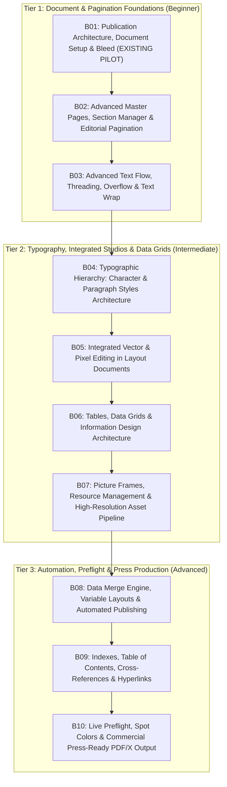

# AFFINITY ACADEMY — PHASE 5 TRACK 3 IMPLEMENTATION PROPOSAL
## Affinity Layout Studio (Track 3): 10-Module Editorial Curriculum & Interactive Simulator

## Document Control
- **Document ID:** `PROPOSAL-PHASE5-TRACK3-001`
- **Release Target:** `v4.3.0`
- **Date:** `2026-11-13`
- **Authoring Agent:** `Lead Architect, Senior Curriculum Engineer, Design System Lead`
- **Associated Requirement:** `REQ-CURR-003`, `REQ-FE-008`, `REQ-QA-001` to `REQ-QA-005`
- **Associated Task:** `TASK-012`
- **Current Status:** `PROPOSED — PENDING EXPLICIT USER AUTHORIZATION (BLK-007 ACTIVE)`

---

## 1. Executive Summary & Strategic Intent

Following the certified release of Track 1 (Designer) and Track 2 (Photo), **Track 3: Affinity Layout Studio Mastery** represents the multi-page editorial, document automation, and commercial print production core of **AFFINITY ACADEMY**.

The current Affinity desktop app brings page layout, vector design, and photo editing into one application and one `.af` document through **Layout**, **Vector**, and **Pixel** studios. Track 3 therefore teaches current in-document editing workflows, Data Merge, master pages, and preflight. A clearly labelled legacy note may compare these workflows with **StudioLink in Affinity V2**; StudioLink must not be presented as the architecture of the current all-in-one app.

This proposal outlines the complete architectural, pedagogical, and technical plan to expand Track 3 from its current 1-module pilot (`B01`) to a full **10-module, 30-lesson production curriculum**, accompanied by an in-browser **Interactive Editorial Page & Text Layout Simulator**, 9 production practice specification guides, Rollup chunk partitioning, and an automated Playwright E2E verification suite.

---

## 2. Curriculum Architecture & 10-Module Inventory

Track 3 retains the existing verified pilot module `B01` without modification, and introduces 9 subsequent modules (`B02` through `B10`) structured into three distinct pedagogical tiers:
- **Foundations Tier (Modules B01–B03):** Document setup, multi-master pagination, and advanced text flow mechanics.
- **Editorial Typography & In-Document Design Tier (Modules B04–B07):** Character/paragraph style hierarchies, integrated Vector and Pixel editing in Layout documents, financial table grids, and image resource management.
- **Advanced Publishing & Commercial Pre-Press Tier (Modules B08–B10):** Data Merge variable automation, interactive document navigation (TOC/Index), and commercial press-ready PDF/X production.



### 2.1. Complete 10-Module & 30-Lesson Syllabus Breakdown

#### Module B01: Publication Architecture, Document Setup & Bleed (Existing Pilot — Retained 100%)
- **B01-01:** *Publication Architecture, Facing Pages, Slug & Bleed Standards* (Commercial print geometry, folding signatures, 3mm ISO bleed, asymmetrical margins with binding gutters).
- **B01-02:** *Master Pages Foundations & Dynamic Page Numbering* (Spread masters vs single masters, dynamic fields `#`, parent-child hierarchy basics).
- **B01-03:** *Baseline Grids, Flow Columns & Frame Margins* (Vertical rhythm, Baseline Grid Manager, multi-column text threading, frame inset padding).

#### Module B02: Advanced Master Pages, Section Manager & Editorial Pagination
- **B02-01:** *Multi-Master Spread Hierarchies, Parent-Child Inheritance & Local Overrides* (Building modular master page trees; applying multiple masters per spread; detached vs synchronized local overrides).
- **B02-02:** *Section Manager, Roman Numerals vs Arabic Folios & Running Headers* (Structuring frontmatter `i, ii, iii`, body `1, 2, 3`, and appendices `A-1`; dynamic running chapter headers via Section Name fields).
- **B02-03:** *Chapter Openers, Unlinked First Pages & Disconnected Master Geometry* (Suppression of folios on blank/chapter-opening right-hand pages; managing spine shifts when inserting/deleting interior pages).

#### Module B03: Advanced Text Flow, Threading, Overflow & Text Wrap
- **B03-01:** *Auto-Flow Engine & Multi-Page Continuous Story Threading* (The Shift-Click overflow icon mechanism; auto-generating hundreds of linked pages from single text stream; detecting hidden overset text).
- **B03-02:** *Text Wrap Engine: Jump, Tight, Inside & Custom Vector Wrap Outlines* (Wrapping text around images, pull-quotes, and irregular vector silhouettes; configuring top/bottom/left/right standoff distances).
- **B03-03:** *Vertical Justification, Balance Columns & Frame Inset Optimization* (Aligning text frames top/center/bottom/justified; auto-balancing column heights; eliminating river patterns in multi-column layouts).

#### Module B04: Typographic Hierarchy: Character & Paragraph Styles Architecture
- **B04-01:** *Hierarchical Paragraph Styles, 'Based On' Cascading & Style Organization* (Establishing Master Body copy; cascading Headings H1/H2/H3; Next Style automation for interview and Q&A layouts).
- **B04-02:** *Character Style Overrides, Nested Styles & GREP-Style Formatting* (Inline bolding, run-in heads, web hyperlinks, optical kerning vs metric kerning; local format override clearing).
- **B04-03:** *Advanced Micro-Typography: Keep Options, Hyphenation Dictionaries & Drop Caps* (Preventing single-line orphans and widows via Keep Lines Together; hyphenation zone tuning; multi-line decorative drop caps).

#### Module B05: Integrated Vector & Pixel Editing in Layout Documents (Current Affinity)
- **B05-01:** *Affinity's Unified Document and Studio Architecture* (Understand the current single-app workflow: Layout, Vector, and Pixel studios operate on the same `.af` document; distinguish this from the separate-app StudioLink workflow in legacy Affinity V2).
- **B05-02:** *Vector Editing Directly in Layout Documents* (Create and refine vector flourishes, decorative rules, corner frames, and spot illustrations on editorial spreads without round-tripping to a separate application).
- **B05-03:** *Pixel Editing and Photo Adjustments in Layout Documents* (Use the Pixel studio for in-document retouching, masks, and supported live adjustments; identify which operations remain non-destructive and which require rasterization or a separate source asset).

#### Module B06: Tables, Data Grids & Information Design Architecture
- **B06-01:** *Table Tool Mechanics: Grid Topology, Auto-Sizing & Multi-Page Continuity* (Inserting tables; row/column insertion; auto-fitting cell widths to text content; handling header row repetition on linked spreads).
- **B06-02:** *Cell Formatting, Alternating Fills, Custom Borders & Table Styles* (Zebra-striping tables for readability; setting cell margin padding; border stroke hierarchies; saving reusable Table Styles).
- **B06-03:** *Financial Tables, Tab Stops with Leader Dots & Inline Data Visualization* (Right-aligning decimal numbers; creating tab stops with dotted leader lines for menus and annual reports; embedding vector mini-charts in cells).

#### Module B07: Picture Frames, Resource Management & High-Resolution Asset Pipeline
- **B07-01:** *Picture Frame Tool (Rectangular, Elliptical & Custom Vector Frames)* (Smart framing: Scale to Fit, Scale to Max, Stretch; the Picture Frame Navigator slider for pan/zoom cropping within frames).
- **B07-02:** *Resource Manager Studio: Embedded vs Linked Assets & Batch Relinking* (Storage footprint considerations; tracking linked folder paths; batch replacing missing/modified high-res assets).
- **B07-03:** *Effective DPI Verification, Color Space Reconciliation & Vector Passthrough* (Distinguishing placed image DPI from Effective Canvas DPI; handling RGB placed images in CMYK documents; PDF vector passthrough).

#### Module B08: Data Merge Engine, Variable Layouts & Automated Publishing
- **B08-01:** *Data Merge Layout Tool: Record Grids, Margins & Repeats* (Creating repeating grid cards on a single page; configuring horizontal and vertical step margins for business cards, labels, and certificates).
- **B08-02:** *Data Source Binding: CSV/TSV Schema, Field Insertion & Record Preview* (Connecting CSV data sources; inserting `<First_Name>`, `<Photo_File>`, `<Price>` tokens into text frames and picture frames).
- **B08-03:** *Automated Multi-Page Document Generation & Catalog Production* (Generating 500-page product catalogs in seconds; filtering records; automated error handling for missing image assets in data feeds).

#### Module B09: Indexes, Table of Contents, Cross-References & Hyperlinks
- **B09-01:** *Table of Contents (TOC) Generation from Paragraph Styles & Dynamic Leader Dots* (Configuring TOC Studio; pulling chapter and section titles automatically; formatting multi-level TOC hierarchies).
- **B09-02:** *Indexing Engine: Marking Index Entries, Hierarchy & Cross-References* (Marking keywords across 200 pages; sub-entries; 'See' and 'See also' cross-references; index alphabetization and formatting).
- **B09-03:** *Interactive Digital Publication: Anchors, Hyperlinks & PDF Interactive Bookmarks* (Creating interactive document anchors; hyperlinking URLs and page references; exporting functional interactive PDF bookmarks).

#### Module B10: Live Preflight, Spot Colors & Commercial Press-Ready PDF/X Output
- **B10-01:** *Live Preflight Panel: Setting Profile Rules, Overset Text & Bleed Warnings* (Configuring custom preflight profiles for Sheetfed Offset vs Digital Press; real-time alerts for missing bleed, overflow text, and low-res graphics).
- **B10-02:** *Spot Colors, Pantone Palettes, Overprint Black & Rich Black* (Assigning spot color inks; understanding 100% K overprint vs Rich Black `C60 M40 Y40 K100` for large solid background fills).
- **B10-03:** *Commercial Print Standards: PDF/X-1a, PDF/X-4, Printer Marks & Commercial Packaging* (Choosing PDF/X-1a flat CMYK vs PDF/X-4 transparency-preserving standards; printer trim marks; File > Save As Package for print shops).

---

## 3. Editorial Workflow & In-Depth Technical Content Specifications

### 3.1. Publishing Workflow & Document Layout
The curriculum enforces commercial-standard production workflows:
1. **Document Setup:** ISO 216 standards (A4, A5), US sizes (Letter, Tabloid), and custom book trim dimensions.
2. **Page Flow:** Facing pages (`Spread`) configured with proper spine orientation. Left-hand verso vs right-hand recto page geometry.
3. **Margins & Gutters:** Binding gutters dynamically calibrated for mechanical binding:
   - *Saddle-stitch:* Gutter margin + 2mm creep allowance for outer signatures.
   - *Perfect bound / Hardcover:* Gutter margin + 8mm to 12mm allowance for spine glue hinge.

### 3.2. Master Pages & Page Management
Publisher's Master Pages architecture is taught through rigorous hierarchical modeling:
- **Parent Master (`Master A - Base Spread`):** Holds global baseline grid, 3mm bleed margin reference, running folios, and outer margin chapter slug.
- **Child Master (`Master B - 3-Column Editorial`):** Inherits Master A; adds 3 linked text frames with 4.5mm column gutters.
- **Child Master (`Master C - Full Bleed Gallery`):** Inherits Master A; overrides folios to dark-mode white text and applies a full-bleed picture frame.
- **Spread Overrides:** Teaches when to use `Edit Detached` (temporary local adjustments) vs `Edit Linked` (broadcasting changes back to all pages).

### 3.3. Typography & Text Flow
Typographic excellence is central to the curriculum:
- **Vertical Rhythm:** Locking paragraph styles to the 12pt/14pt document baseline grid.
- **Hyphenation & Justification (H&J):** Tuning minimum/desired/maximum word spacing (80% / 100% / 133%) and letter spacing (-2% / 0% / 2%) to eliminate rivers and gaps in justified text.
- **Keep Options:** Setting `Keep with next 2 lines` on Headings to eliminate trailing headings at the bottom of pages; `Prevent Orphan Lines` (2 lines minimum).

### 3.4. Tables, Graphics & Resource Placement
- **Tables:** Modeled as semantic layout containers with row/column spans, alternating shading rules, and numeric right-alignment.
- **Picture Frames:** Vector containers with non-destructive image positioning, pan/zoom scaling, and dynamic clipping.
- **Resource Management:** Linked vs embedded file trade-offs, DPI recalculation on scaling, and pre-press asset relinking.

### 3.5. Preflight, PDF Export & Print Production
- **Live Preflight:** The real-time background auditor in Affinity Publisher that flags overset text, missing fonts, RGB images in CMYK profiles, and artwork violating 3mm bleed.
- **PDF/X Standards:**
  - *PDF/X-1a:2001:* Complete flattening of transparency; all color converted strictly to CMYK + spot colors. Essential for legacy offset presses.
  - *PDF/X-4:* Preserves live transparencies, vector layers, and device-independent color for modern RIPs.

---


### 3.3. Product-version scope and legacy StudioLink note

This proposal targets the current Affinity desktop application documented by Affinity as one app containing Layout, Vector, and Pixel studios, working within one `.af` document. It does **not** assume the legacy `.afpub` / `.afdesign` / `.afphoto` three-app architecture.

**Legacy-only note:** StudioLink belongs to the separate Affinity V2 application family. Any lesson or setup appendix that discusses V2 installation packaging (MSIX versus MSI/EXE) must be explicitly labelled V2 legacy guidance, cite the applicable Serif support documentation, and be validated against the exact V2 application builds being taught. Do not generalize those installer constraints to the current all-in-one Affinity application. This proposal does not assert a universal same-license or exact `3.3.3` build requirement.

**Current-product references:**
- Affinity, Page Layout: https://www.affinity.studio/page-layout-software
- Affinity, Get Affinity: https://www.affinity.studio/get-affinity
- Affinity, Switching to Affinity: https://www.affinity.studio/blog/switching-to-affinity-for-adobe-users

## 4. Practice Assets Architecture (B02–B10)

Following ADR-016 and the proven methodology of Track 2, 9 production-grade practice guides (`GUIDE_DOCUMENT`) will be authored in `curriculum/assets/publisher/`:

| Asset File | Target Module | Document Specification |
|---|---|---|
| `B02_master_pages_pagination_guide.md` | B02 | 16-page magazine signature, frontmatter Roman folios, Chapter opener setup |
| `B03_text_flow_text_wrap_guide.md` | B03 | 8-page feature article, multi-column Auto-Flow, wrap around silhouette cutouts |
| `B04_typography_styles_guide.md` | B04 | Complete corporate editorial style sheet (H1, H2, Lead, Body, Pull-quote, Byline) |
| `B05_integrated_studios_workflow_guide.md` | B05 | Current Affinity `.af` mixed-media publication: vector artwork and pixel-edited portraits in one document; includes a clearly separated legacy V2 StudioLink comparison |
| `B06_tables_data_grids_guide.md` | B06 | Corporate annual report: financial summary table, zebra-striping, leader tabs |
| `B07_picture_frames_resources_guide.md` | B07 | Multi-image architecture magazine layout: picture frame crops, linked asset audit |
| `B08_data_merge_catalog_guide.md` | B08 | Automated 12-page retail product catalog generated from structured CSV feed |
| `B09_toc_index_interactive_guide.md` | B09 | 48-page technical manual: automated multi-level TOC and indexed keyword index |
| `B10_preflight_pdfx_production_guide.md` | B10 | Commercial preflight checklist, spot Pantone ink assignment, press-ready PDF/X-4 |

---

## 5. In-Browser Interactive Editorial Simulator

To deliver hands-on tactile practice without requiring desktop software, an in-browser **Interactive Editorial Page & Text Layout Simulator** will be built:

- **Component Path:** `src/components/simulator/PublisherLayoutSimulator.tsx`
- **Hosted At:** `src/pages/SimulatorPage.tsx` (as a 3rd tab: Vector Bézier, Photo Layers, and Editorial Layout).
- **Core Simulated Capabilities:**
  1. *Interactive Facing-Page Spread:* Canvas/SVG rendering of Left Page (Verso) and Right Page (Recto), showing spine gutter, margins, and outer 3mm bleed margin boundary.
  2. *Live Baseline Grid Toggle:* Visual switch displaying baseline grid rungs (12px/14px ladder); toggle button to "Lock Text to Baseline Grid" showing lines dynamically snapping to horizontal rungs across both pages.
  3. *Interactive Text Wrap Obstacle:* Draggable image/shape element placed between two text columns; text automatically shifts and wraps in real-time with adjustable Standoff Offset slider (0px to 24px).
  4. *Multi-Column Flow & Threading:* 2-column and 3-column text frame toggles with gutter controls; visual thread line linking column 1 to column 2.
  5. *Dynamic Master Page Folios:* Interactive input for Publication Title, Chapter Name, and starting page number broadcasting automatically to left/right folios.
  6. *Educational Disclaimer:* Prominent banner affirming the component is an educational model and not a native desktop replacement.

---

## 6. Bundle Performance & Code-Splitting Strategy

To ensure zero bundle degradation from adding 27 comprehensive lessons, `vite.config.ts` will partition Track 3:

```ts
// Proposed chunk partition in vite.config.ts
if (id.includes('curriculum/publisher/B01') || id.includes('curriculum/publisher/B02') ||
    id.includes('curriculum/publisher/B03') || id.includes('curriculum/publisher/B04') ||
    id.includes('curriculum/publisher/B05')) {
  return 'curriculum-publisher-foundations'; // ~255 kB
}
if (id.includes('curriculum/publisher/B06') || id.includes('curriculum/publisher/B07') ||
    id.includes('curriculum/publisher/B08') || id.includes('curriculum/publisher/B09') ||
    id.includes('curriculum/publisher/B10')) {
  return 'curriculum-publisher-advanced'; // ~250 kB
}
```

This guarantees:
- Main application bundle `index.js` remains ~140 kB.
- All curriculum chunks remain comfortably below the 300 kB threshold.
- Zero chunk size warnings during production builds.

---

## 7. QA Acceptance Criteria & Playwright Verification Plan

### Acceptance Criteria for Track 3 Sign-Off
1. **Schema Validation:** `npm run validate:curriculum` must pass across all **93 lessons** (30 Designer + 30 Photo + 30 Publisher + 3 Scripting) with **0 errors**.
2. **Type Safety:** `npm run typecheck` must pass with **0 TypeScript compiler errors**.
3. **Build Integrity:** `npm run build` must complete cleanly with **0 chunk size warnings**.
4. **Scripting Regression:** `npm run test:scripts` must pass **3/3 scripts**.
5. **Playwright E2E Suite:** Must create `tests/e2e/publisher-curriculum.spec.ts` testing:
   - `TC-PUB-01`: Course Catalog filters Publisher track to 10 modules and 30 lessons.
   - `TC-PUB-02`: SlidePlayer launches and navigates a full Publisher lesson (`B02-01`).
   - `TC-PUB-03`: Publisher Layout Simulator renders facing spread, baseline grid toggle, and interactive text wrap.
   - Total Playwright test count increases from 9 to **12 passing tests**.

---

## 8. Governance & Approval Protocol

- **Current Status:** **HALTED AT PHASE GATE (BLK-007)**.
- **Authorization Requirement:** Under multi-agent governance rules, no files for Track 3 (modules `B02`–`B10`, simulator, or tests) may be written until the Project Owner reviews this proposal and grants explicit written authorization.
