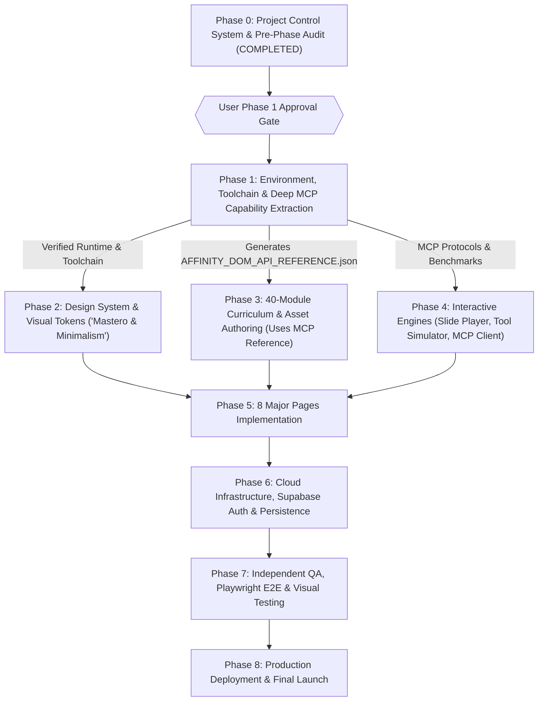

# AFFINITY ACADEMY — DEPENDENCY-AWARE ROADMAP

## Document Control
- **Document ID:** `ROADMAP-AFFINITY-001`
- **Version:** `2.2.0` (Phase 2 Completed)
- **Status:** `ACTIVE / AUDITED & EXPANDED`
- **Current Active Phase:** `PHASE 2 (COMPLETED) -> AWAITING APPROVAL FOR PHASE 3`
- **Last Updated:** `2026-11-09`
- **Governing Agent:** `Orchestrator`

---

## 1. Roadmap Architecture & Execution Philosophy

The execution of **Affinity Academy** is strictly dependency-aware. The revised roadmap enforces that **Affinity MCP research, capability extraction, and local environment verification must be completed first** before curriculum authoring and frontend development begin.

---

## 2. Phase Breakdown & Milestones

### Phase 0: Project Control System Initialization & Pre-Phase Audit
- **Goal:** Establish multi-agent rules, task registry, 40-module master spec, requirements traceability, and complete pre-phase audit.
- **Status:** **COMPLETED**
- **Exit Criteria:** All control files verified, 10-point audit completed in `PRE_PHASE_AUDIT.md`, zero application code modified.

---

### [GATEWAY]: User Approval Required to Proceed to Phase 1
> [!IMPORTANT]
> The agent stops immediately after the audit. No execution of Phase 1 may occur until the user grants explicit approval.

---

### Phase 1: Environment, Toolchain & Deep Affinity MCP Capability Extraction
- **Goal:** Verify Node.js/Vite/TypeScript/Tailwind toolchain; perform deep inspection of live Affinity 3.0 DOM via MCP (`list_sdk_documentation`, `read_sdk_documentation_topic`, `execute_script`, `render_spread`); produce `AFFINITY_DOM_API_REFERENCE.json` and latency benchmark report.
- **Prerequisites:** Phase 0 completion & User Approval.
- **Status:** **COMPLETED (QA Signed Off)**
- **Associated Tasks:** `TASK-002`, `TASK-003`, `TASK-004`, `TASK-005`, `TASK-006`
- **Governing Agents:** `AffinityMCPAgent`, `FrontendAgent`
- **Exit Criteria:** `AFFINITY_DOM_API_REFERENCE.json` created with 100% extracted topics; live script execution and render tests succeed with latency logs; clean toolchain setup.

---

### Phase 2: Design System & Visual Foundations ("Mastero & Minimalism")
- **Goal:** Establish the visual identity, dark/light theme tokens, refined typography scale, and reusable UI component primitives in code tokens and living preview.
- **Prerequisites:** Phase 1 completion & User Approval.
- **Status:** **COMPLETED (QA Signed Off)**
- **Associated Tasks:** `TASK-020`
- **Governing Agents:** `DesignAgent`, `FrontendAgent`
- **Exit Criteria:** `src/styles/tokens.css` and Tailwind theme configured; 21 reusable components built; accessible contrast ratios verified; zero TS errors; clean build.

---

### [GATEWAY]: User Approval Required to Proceed to Phase 3
> [!IMPORTANT]
> The agent stops immediately after Phase 2 completion and QA sign-off. No execution of Phase 3 (Curriculum & Asset Authoring) may occur until the user grants explicit approval.

---

### Phase 3: 40-Module Curriculum Development & Asset Authoring
- **Goal:** Author all 40 modules (120 lessons) across Designer, Photo, Publisher, and Scripting tracks based on the ground truth MCP API reference; build tool encyclopedia dataset, starter assets (`.af*`), and challenge solutions.
- **Prerequisites:** Phase 1 (MCP API Reference).
- **Status:** **TRACK 1 COMPLETE & TECHNICAL RE-AUDIT VERIFIED** (10 Modules, 30 Lessons). Pilot modules for P01, B01, S01 verified.
- **Associated Tasks:** `TASK-010`, `TASK-010-REAUDIT`, `TASK-011`, `TASK-012`, `TASK-013`, `TASK-014`, `TASK-015`, `TASK-016`, `TASK-017`
- **Governing Agents:** `CurriculumAgent`, `DesignAgent`, `AffinityMCPAgent`
- **Exit Criteria:** All lessons pass `validate:curriculum`; technical claims verified in `TRACK_1_REAUDIT_REPORT.md`.

---

### Phase 4: Core Interactive Engine Development
- **Goal:** Build the interactive engines: Interactive Slide-Based Lesson Engine, In-Browser Affinity Tool Simulator Sandbox (Pen, Node, Boolean, Curves), Monaco Script Editor, Live Render Preview Viewport, and MCP Client Bridge.
- **Prerequisites:** Phase 1, Phase 2.
- **Status:** **PHASE 4 MVP COMPLETED & SIGNED OFF** (`SlidePlayer.tsx` and `PenNodeSimulator.tsx` Operational; Monaco & MCP Playground deferred per phase gate).
- **Associated Tasks:** `TASK-026` (Completed), `TASK-027` (Completed), `TASK-074` (Completed), `TASK-023` (Pending), `TASK-024` (Pending), `TASK-040` (Pending)
- **Governing Agents:** `FrontendAgent`, `AffinityMCPAgent`, `QAAgent`
- **Exit Criteria:** `PHASE_4_MVP_SIGNOFF.md` verified; 5/5 Playwright E2E tests pass; 0 regressions.

---

### Phase 5: 8 Major Pages Implementation (Web Platform)
- **Goal:** Build the 8 dedicated major pages:
  - `PAGE-01`: Home / Landing Page (`TASK-071`)
  - `PAGE-02`: Course Catalog & Tracks Browser (`TASK-072`)
  - `PAGE-03`: Interactive Slide-Based Lesson Player (`TASK-073`)
  - `PAGE-04`: Interactive Tool Simulator Sandbox (`TASK-074`)
  - `PAGE-05`: Tool Encyclopedia & Shortcuts Matrix (`TASK-075`)
  - `PAGE-06`: Live Scripting & MCP Automation Playground (`TASK-076`)
  - `PAGE-07`: Resource Library & Asset Download Center (`TASK-077`)
  - `PAGE-08`: Student Dashboard & Portfolio (`TASK-078`)
- **Prerequisites:** Phase 2, Phase 3, Phase 4.
- **Status:** `PENDING`
- **Associated Tasks:** `TASK-021`, `TASK-022`, `TASK-028`, `TASK-029`, `TASK-071` to `TASK-078`
- **Governing Agents:** `FrontendAgent`, `DesignAgent`
- **Exit Criteria:** All 8 pages navigable, responsive, adhering strictly to content specifications with zero broken routes.

---

### Phase 6: Cloud Infrastructure, Authentication & Persistence
- **Goal:** Deploy Supabase schema for 40 modules and 120 lessons, RLS security policies, Supabase Auth, storage buckets for starter assets/submissions, and progress persistence client.
- **Prerequisites:** Phase 5 completion.
- **Status:** `PENDING`
- **Associated Tasks:** `TASK-030`, `TASK-031`, `TASK-032`, `TASK-033`
- **Governing Agents:** `BackendAgent`
- **Exit Criteria:** Database migrations applied; authentication tested; progress persists and restores across reloads.

---

### Phase 7: Independent Quality Assurance & Automated Playwright Verification
- **Goal:** Independent verification by `QAAgent`: End-to-end Playwright tests across all 8 major pages; visual regression snapshot tests; automated runner verifying all 30 scripting exercises against live Affinity MCP; static typecheck.
- **Prerequisites:** Phase 6 completion.
- **Status:** `PENDING`
- **Associated Tasks:** `TASK-050`, `TASK-051`, `TASK-052`, `TASK-053`, `TASK-054`
- **Governing Agents:** `QAAgent`
- **Exit Criteria:** 100% of Playwright tests pass; 0 visual regressions; 0 script execution failures; formal QA sign-off.

---

### Phase 8: Production Deployment, Documentation & Final Launch
- **Goal:** Production build optimization, Netlify hosting deployment, environment security audit, comprehensive onboarding documentation, and final handoff.
- **Prerequisites:** Phase 7 completion.
- **Status:** `PENDING`
- **Associated Tasks:** `TASK-060`, `TASK-061`, `TASK-062`
- **Governing Agents:** `Orchestrator`, `BackendAgent`
- **Exit Criteria:** Live Netlify deployment verified; all documentation complete.
